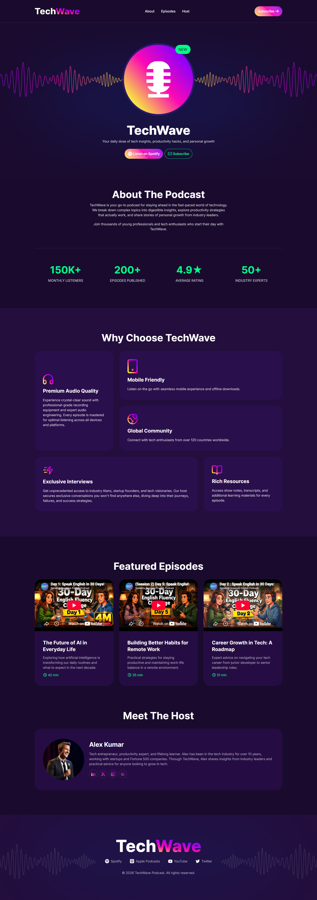
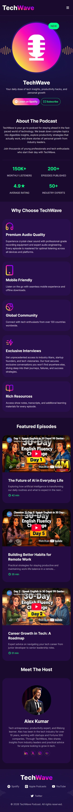

# TechWave – Podcast Landing Page

A fully responsive landing page for a fictional tech podcast, built from a Figma design using **HTML5** and **Tailwind CSS v4** — no JavaScript.

🔗 **Live Demo:** [moshiur008.github.io/techwave](https://moshiur008.github.io/techwave/)

## Screenshots

| Desktop | Mobile |
| :-----: | :----: |
|  |  |

## Features

- Pixel-conscious implementation of the provided Figma design (desktop and mobile layouts)
- Fully responsive across small, medium and large screens
- Hero section with a layered background, podcast circle and a positioned "New" badge
- Statistics section: 4 columns on desktop, 2×2 grid on mobile
- "Why Choose" section built with CSS Grid using `row-span` and `col-span`
- Featured episodes with embedded YouTube videos (privacy-enhanced `youtube-nocookie` embeds, lazy-loaded)
- Host section with social links that stacks on mobile
- Smooth scrolling between sections
- Hover animations on buttons, with `prefers-reduced-motion` respected
- Semantic HTML (`header`, `nav`, `main`, `section`, `footer`) with accessible labels for icon-only links

## Built With

- HTML5
- [Tailwind CSS v4](https://tailwindcss.com/) (browser build)
- [Font Awesome](https://fontawesome.com/) for icons
- [Google Fonts – Inter](https://fonts.google.com/specimen/Inter)

## Project Structure

```
techwave/
├── index.html
├── images/
├── screenshots/
└── README.md
```

## Run Locally

No build step is required.

```bash
git clone https://github.com/moshiur008/techwave.git
cd techwave
```

Then open `index.html` in your browser, or use the VS Code **Live Server** extension.

## What I Learned

- Converting a Figma design into clean, responsive code with Tailwind utility classes
- Extracting repeated utilities into component classes with `@layer components` and `@apply`
- Defining design tokens (colors, fonts) with Tailwind v4's `@theme`
- Building complex layouts with CSS Grid and Flexbox
- Accessibility basics: `alt` text vs. decorative images, `aria-label` on icon links, descriptive iframe titles, reduced motion
- Deploying a static site with GitHub Pages (and handling case-sensitive file names)

## Known Limitations

- The mobile menu button is visual only (the assignment forbids JavaScript)
- Tailwind runs through the browser build, which is convenient for learning but not recommended for production; a build step (e.g. Vite) would improve performance
- Social and platform links are placeholders

## Author

**Moshiur**

- GitHub: [@moshiur008](https://github.com/moshiur008)
- LinkedIn: [moshiur008](https://www.linkedin.com/in/moshiur008/)

---

Built as part of the Programming Hero Level 1 course (Assignment 002). The design and text content are for practice purposes only.
